# tc_ble_sdk 快速入门 

## 概述 

### 关于本文档 

本文档旨在帮助您快速完成 tc_ble_sdk 开发环境的搭建、SDK 获取、工程的编译与烧录，并成功运行第一个示例工程。阅读本文档，需要您具备 C 语言基础、嵌入式开发基本概念。

### 适用范围 

tc_ble_sdk 适用于泰凌微电子 TLSR825x、TLSR827x、TC321x、TC123x 等系列的 SoC：

- [TLSR825x](https://doc.telink-semi.cn/doc/datasheet/DS-TLSR8258-E_Datasheet_for_Telink_Multi-Standard_Wireless_SoC_TLSR8258.pdf)
- [TLSR827x](https://doc.telink-semi.cn/doc/datasheet/DS-TLSR8278-E_Datasheet_for_Telink_Multi-Standard_Wireless_SoC_TLSR8278.pdf)
- [TC321x](https://doc.telink-semi.cn/doc/datasheet/DS-TC321x-E_Datasheet_for_Telink_SoC_TC3216_TC3215.pdf)

!!! note "注意"

    此处列出的信息可能不是最新版本。关于完整、准确的芯片型号、对应的开发板、开发平台以及 SDK 版本的详细信息，请参阅最新的 *Release Notes*。打开 [Release Notes](https://gitee.com/telink-semi/tc_ble_sdk/blob/master/doc/) 页面后，通过左侧下拉列表，选择与您当前使用的 SDK 版本对应的 Release Notes 查看。

## 开发准备 

### 硬件准备 

| 硬件      | 说明                                                |
| ------- | ------------------------------------------------- |
| PC      | Windows 10/11 / Linux / macOS (本文档以 Windows 为例说明) |
| 开发板     | 根据 *Release Notes*，选取合适的开发板                       |
| 烧录器     | 推荐使用 Programmer V3                                |
| USB 数据线 | 连接 PC 和烧录器                                        |
| 杜邦线     | 连接开发板和烧录器                                         |

硬件实物，请参考章节[连接硬件](#步骤一连接硬件)。

### 软件准备 

| 软件   | 说明                                                                                                          |
| ---- | ----------------------------------------------------------------------------------------------------------- |
| IDE  | [Telink VS Code Extension](#telink-vs-code-extension-开发环境) 或 [Telink IoT Studio](#telink-iot-studio-开发环境)   |
| 工具链  | 工具链信息，请参阅 *Release Notes*                                                                                   |
| 烧录工具 | BDT (Burning and Debugging Tool)                                                                            |
| SDK  | [Github](https://github.com/telink-semi/tc_ble_sdk) / [Gitee](https://gitee.com/telink-semi/tc_ble_sdk.git) |

## 选择开发环境 

tc_ble_sdk 支持以下两种开发方式：

- 方式1：[Telink VS Code Extension](#telink-vs-code-extension-开发环境)
- 方式2：[Telink IoT Studio](#telink-iot-studio-开发环境)

根据您的开发习惯选择其中一种即可。两种方式无需同时安装。

### Telink VS Code Extension 开发环境 

#### 安装 VS Code 

在安装插件之前，请确保您的电脑上已安装最新版本的 [Visual Studio Code](https://code.visualstudio.com/)。Telink VS Code Extension 的更新基于当前 VS Code 的最新版本。若 VS Code 版本过低，可能会导致插件无法正常工作或功能异常。

#### 安装Telink VS Code Extension 

1. 启动 VS Code。
2. 点击左侧活动栏的 Extensions（扩展）图标，或使用快捷键 **Ctrl+Shift+X**。
3. 在搜索框中输入 Telink。
4. 在搜索结果中找到 **Telink Development Tool**，点击 **Install**。

    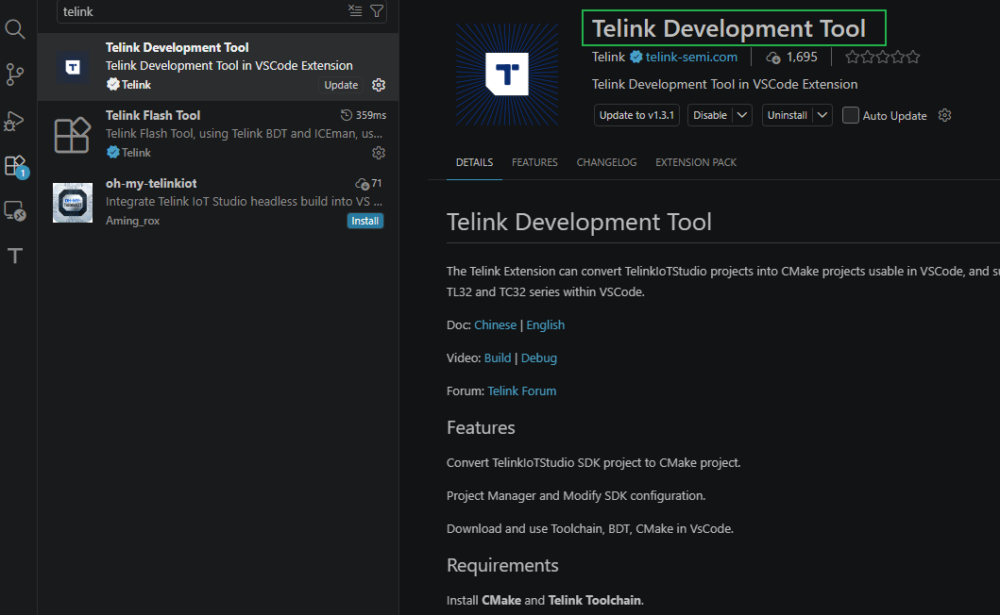

安装完成后，在 VS Code 左侧活动栏中将显示 **Telink DEVELOPMENT** 图标

#### 安装工具链 

在 Telink VS Code Extension 中，通过插件内置的管理器按需下载编译器工具链和辅助工具。

1\. 在 VS Code 左侧的 **Telink DEVELOPMENT** 视图中，展开 **DEVELOPMENT TOOLS** 树状菜单。

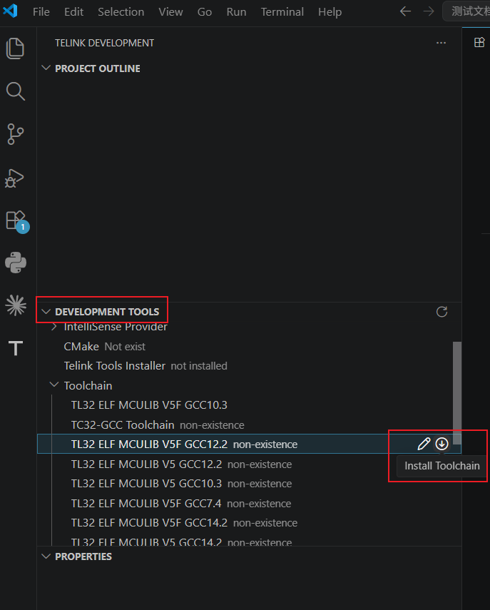

2\. 单击需要的工具链，点击右侧 **Install Toolchain**。

3\. 单击 **CMake**，点击右侧 **Install Toolchain**。

4\. 安装成功后，VS Code 窗口右下角会弹出对应的完成通知。

!!! info "说明"

    如果要在命令行环境中使用工具链，右键单击，在弹出的菜单中点击 **Open Terminal**。

#### 环境验证 

完成安装后，请按照以下步骤验证 **Telink VS Code Extension** 是否安装成功：

1. 启动 VS Code，确认软件能够正常打开，且启动过程中没有报错信息。
2. 在左侧活动栏中确认出现 **Telink** 图标，点击该图标进入 **Telink DEVELOPMENT** 视图。
3. 在 **DEVELOPMENT TOOLS** 树状菜单中，确认需要的工具链已经安装。
4. 同时确认辅助工具 **CMake** 右侧也显示已经安装。

如果以上检查均正常，则说明 **Telink VS Code Extension** 及其依赖工具已成功安装并配置完成，可以开始[下载 SDK](#下载-sdk) 开始 SDK 的开发。

### Telink IoT Studio 开发环境 

#### 下载并安装 Telink IoT Studio 

请根据您的操作系统下载对应的安装包，后续演示将以 Windows 为例：

- Windows : [TelinkIoTStudio\_V2025.2.zip](https://doc.telink-semi.cn/tools/telink_iot_studio/TelinkIoTStudio_V2025.2.zip)
- Linux : [Telink\_IoT\_Studio\_2025.2\_Installer.run](https://doc.telink-semi.cn/tools/telink_iot_studio/Telink_IoT_Studio_2025.2_Installer.run)

**Telink IoT Studio 的安装步骤：**

Windows 环境：

1. 解压下载的 `.zip` 压缩包，运行 *TelinkIoTStudio\_V2025.2.exe*，按照向导完成安装。
2. 安装完成后，必须运行 *TelinkIoTStudio Updater.exe* 以获取最新的组件更新。

Linux 环境：

1. 针对运行环境赋予安装包执行权限。
2. 运行 [Telink\_IoT\_Studio\_2025.2\_Installer.run](https://doc.telink-semi.cn/tools/telink_iot_studio/Telink_IoT_Studio_2025.2_Installer.run) 并按照终端提示完成安装。

#### 工具链说明 

Telink IoT Studio 提供了一站式的独立安装包，内置了开发所需的所有组件，无需进行额外的工具链安装。所有必需的工具链均在安装 IDE 时已经同步安装。通过点击顶部菜单栏的 **Telink**，打开对应工具链的 **Cygwin Shell**。

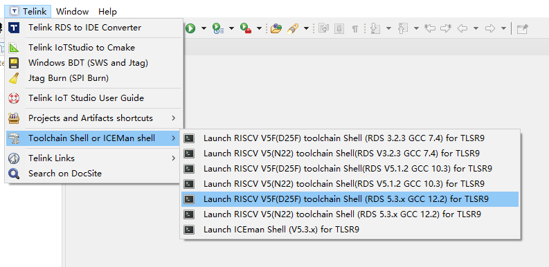

#### 环境验证 

安装完成后，请按照以下步骤验证 **Telink IoT Studio** 是否安装成功。

验证 IDE 安装：

1. 启动 **Telink IoT Studio**，确认程序能够正常加载并显示主界面，且启动过程中没有出现缺失依赖库等错误提示。
2. 点击顶部菜单栏 **Telink**，确认下拉菜单中的 **Cygwin Shell** 等工具链入口可正常打开。

满足以上条件，说明 **Telink IoT Studio** 已安装并配置成功。

验证基础依赖：

SDK 的编译和版本管理依赖以下工具，请在系统终端执行相应命令进行验证。

| 依赖项    | 验证命令                                     | 预期版本                        |
| ------ | ---------------------------------------- | --------------------------- |
| Python | `python --version` 或 `python3 --version` | Python 3.8 或更高（建议 3.8～3.12） |
| Git    | `git --version`                          | Git 2.30 或更高                |

确认以上依赖均已正确安装后，可以开始[下载 SDK](#下载-sdk) 开始 SDK 的开发。

## 获取 SDK 

本章介绍如何获取 Telink 官方 SDK、SDK 的顶层目录结构，以及如何将 SDK 工程导入至 IDE 中。

### 下载 SDK 

通过 [Github](https://github.com/telink-semi/tc_ble_sdk) / [Gitee](https://gitee.com/telink-semi/tc_ble_sdk.git) 下载最新版 SDK，或执行以下 git clone 命令，将仓库克隆至本地：

`git clone https://github.com/telink-semi/tc_ble_sdk.git`

或

`git clone https://gitee.com/telink-semi/tc_ble_sdk.git`

### SDK 目录概览 

tc_ble_sdk/

├── algorithm/ # 算法库

├── application/ # 通用应用处理程序

├── boot/ # 启动代码

├── common/ # 通用工具函数

├── drivers/ # 外设驱动

├── proj\_lib/ # 核心库（协议栈、PM等）

├── stack/ # 协议栈

└── vendor/ # 用户应用代码

完整目录结构及各目录职责请参考[开发手册](https://doc.telink-semi.cn/doc/zh/software/res/sdk/ble/tc_ble_sdk_multi_connection_cn/tc_ble_sdk_multi_connection_cn/)。

### 导入工程 

根据您的开发环境，选择 VS Code 导入工程或者 Telink IoT Studio导入工程。

#### 在 VS Code 中导入工程 

tc_ble_sdk 为标准的 Telink VS Code Extension 工程，直接点击 VS Code 菜单栏的 **File** -> **Open Folder**...，选择该工程的根目录加载即可。

工程加载后，点击左侧活动栏中的 **Telink** 图标，进入 Telink Extension 视图。此时 **PROJECT OUTLINE** 面板显示当前工程的目录结构，表示工程已成功导入。

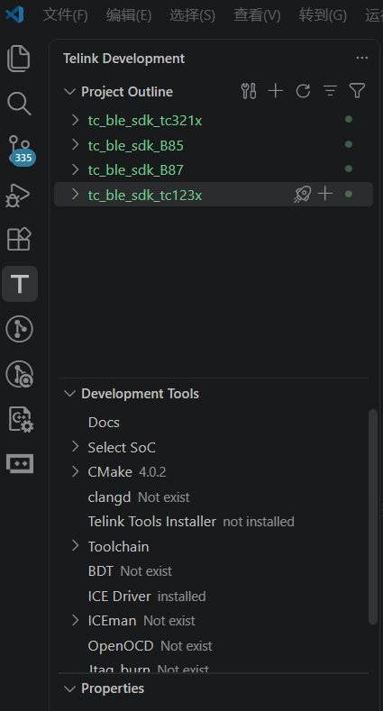

工程加载后，若 **PROJECT OUTLINE** 面板为空，则说明当前工程为旧版 Telink IoT Studio 工程，需要执行转换操作。

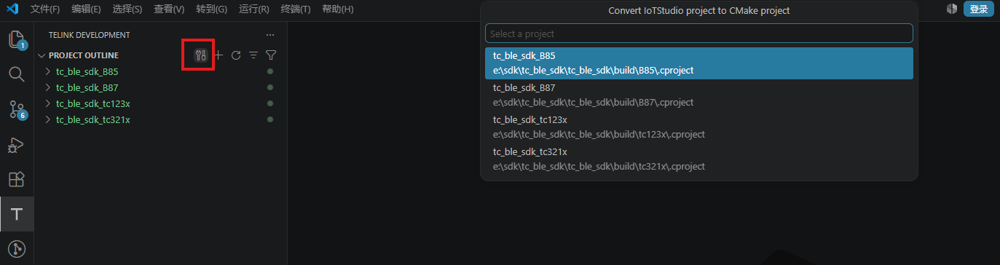

工程导入成功后，在 [VS Code 中编译工程](#在-vs-code-中编译工程)。

#### 在 Telink IoT Studio 中导入工程 

若您选择使用 Telink IoT Studio 作为开发环境，请按照以下步骤导入工程：

1. 点击顶部菜单栏 **File** -> **import**。
2. 在弹出的对话框中展开 **General** 目录，选择 **Existing Projects into Workspace** ，点击 **Next**。
3. 选择工程目录导入。

    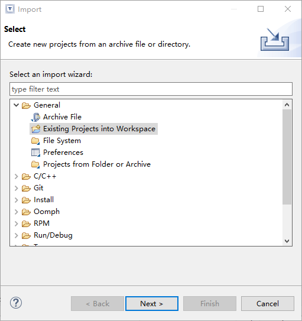

4. 选择 **Browse** 已经下载好的工程,选择相应芯片平台的工程，点击 **Finish**，一个工程导入成功。

    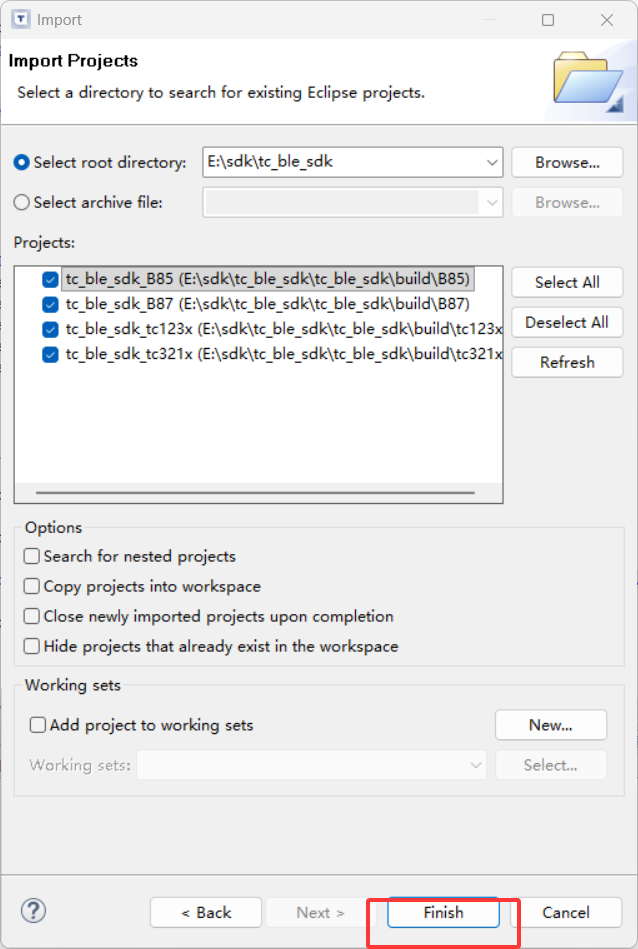

工程导入成功后如下图所示：

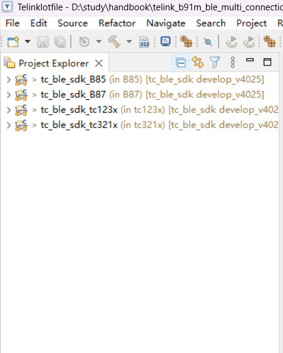

工程导入成功后，在 [TelinkIoT Studio 中编译工程](#在-telink-iot-studio-中编译工程)。

## 编译并运行第一个示例 

本章将引导您完成从选择示例、代码编译，到最终烧录并运行的完整开发闭环。

### 选择示例 

建议使用官方提供的`acl_peripheral_demo`作为第一个示例工程。该示例功能精简、依赖少，可快速验证开发板作为 BLE Peripheral 的基本连接功能。本示例选用 TC321x 开发板进行演示。

更多示例请参考 *...\tc\_ble\_sdk\tc\_ble\_sdk\vendor*。

### 编译工程 

根据您的开发环境，选择 VS Code 编译工程或者 Telink IoT Studio 编译工程。

#### 在 VS Code 中编译工程 

1. 在 VS Code 左侧侧边栏中找到 **PROJECT OUTLINE**，在 **Other targets** 目录下，选择`acl_peripheral_demo`工程。

    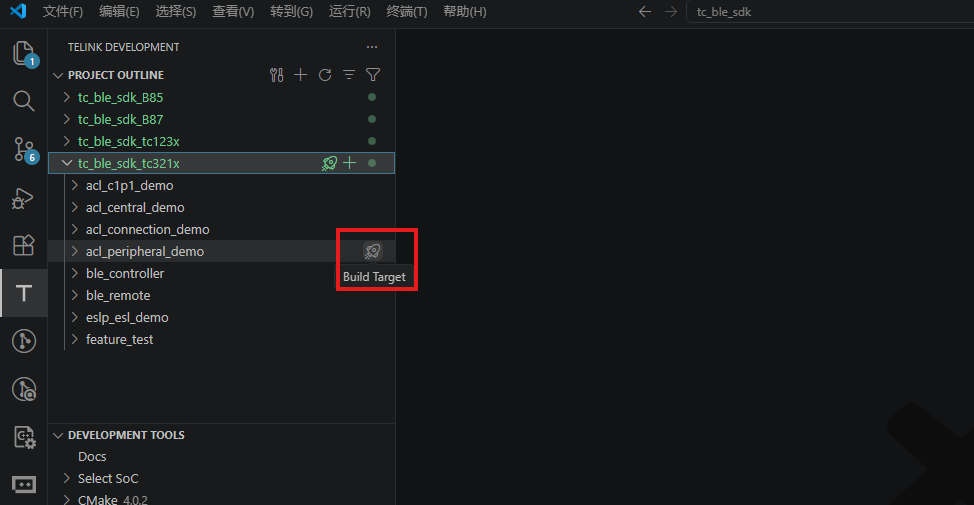

2. 点击右侧的编译按钮进行编译。

    编译完成后，输出文件（`.elf`、`.bin`、`.ls`），其中 `ELF` 格式的文件用于调试，`BIN` 格式的文件则用于烧录。

    `ELF` 文件和 `BIN` 文件可以在编译后在 **PROJECT OUTLINE**下找到，以 TL321x 平台的 `acl_peripheral_demo` 为例，存储路径为 *...\tc\_ble\_sdk\tc\_ble\_sdk\cmake\_builds\TC\_BLE\_SDK\_321X\TC32\_ELF\_MCULIB\_V5\_GCC12\_2*

    编译成功，看到类似的输出：

    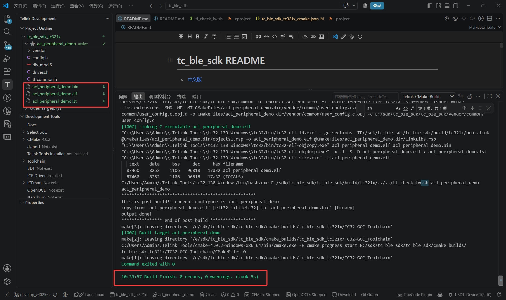

#### 在 Telink IoT Studio 中编译工程 

1. 在左侧 **Project Explorer** 中选中要编译的工程。
2. 点击顶部工具栏 Build 按钮（锤子图标）旁边的下拉小箭头。
3. 在下拉菜单中选中您要编译的配置（Configuration），系统即开始编译。

    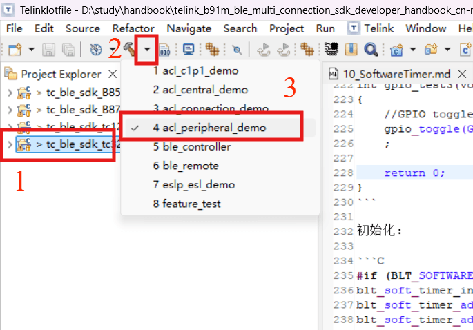

4. 观察控制台（Console）输出，若无报错信息并显示 **Build Finished**，则表示编译成功。

    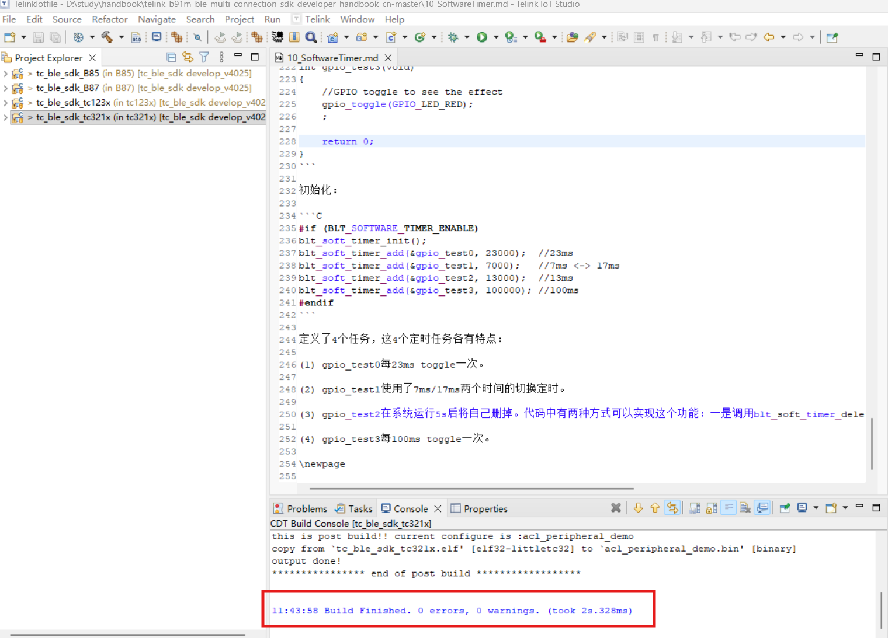

以 TC321x 平台的`acl_peripheral_demo` 为例，编译产生的 `bin` 文件存放在 *...\tc\_ble\_sdk\tc\_ble\_sdk\build\TC321X\acl\_peripheral\_demo* 目录下。

### 烧录程序 

通过 BDT 工具进行固件烧录。

#### 步骤一：连接硬件 

在使用 BDT 工具前，请按照以下逻辑连接电脑、烧录器与目标板：

- PC ↔ 烧录器 (Programmer)：使用 USB 数据线连接。若烧录器上的绿色指示灯常亮，表明烧录器已被 PC 成功识别。
  
- 烧录器 (Programmer) ↔ 目标板：使用杜邦线连接：
  
    - 电源线：VCC ↔ VCC；GND ↔ GND
    
    - 数据线（单线 SWM 总线）：将烧录器的 SWM 引脚连接至目标板的 SWS (Swire) 引脚。

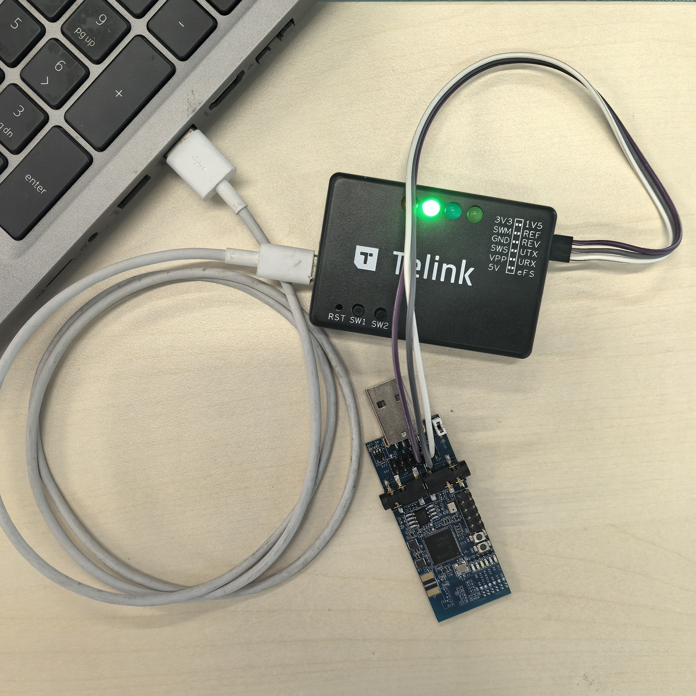

#### 步骤二： 安装 BDT 

1. 下载 BDT 。

    访问 [Telink 开发者中心 - 开发工具](https://www.telink-semi.cn/development-tools)，根据您的操作系统下载对应的工具包。

    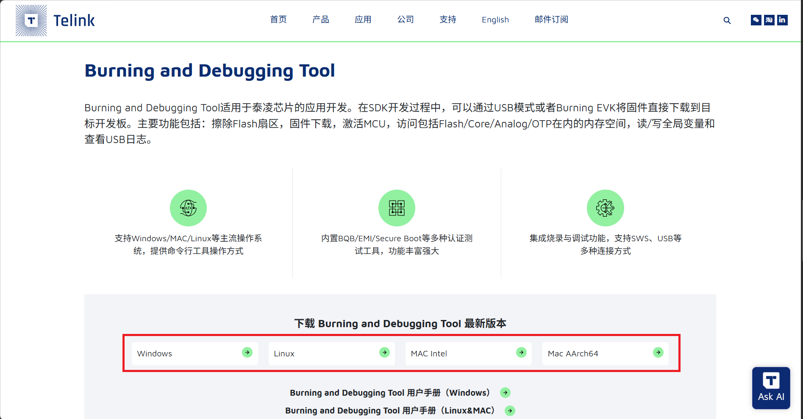
2. 解压缩工具包。（BDT 工具为绿色免安装版，解压即可使用。）

    以 Windows 为例:

    首先，将下载的工具包解压到自定义的路径，例如 *C:\Telink\BDT*。

    然后，进入解压后的发布目录，例如 *C:\Telink\BDT\release\_v5.9.2* 。

    最后，双击运行 *Telink BDT.exe* 即可启动该工具。

    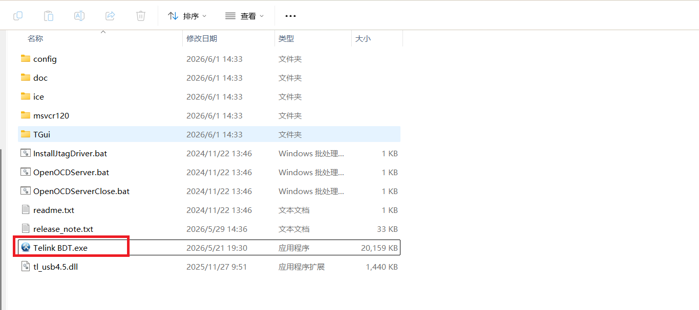
3. 选择烧录器版本与芯片兼容性

    Telink 提供了四个版本的烧录器（Programmer）。在启动 BDT 界面时，推荐选择 **Programmer V1.0 ~ V3.0** 的烧录器版本。

    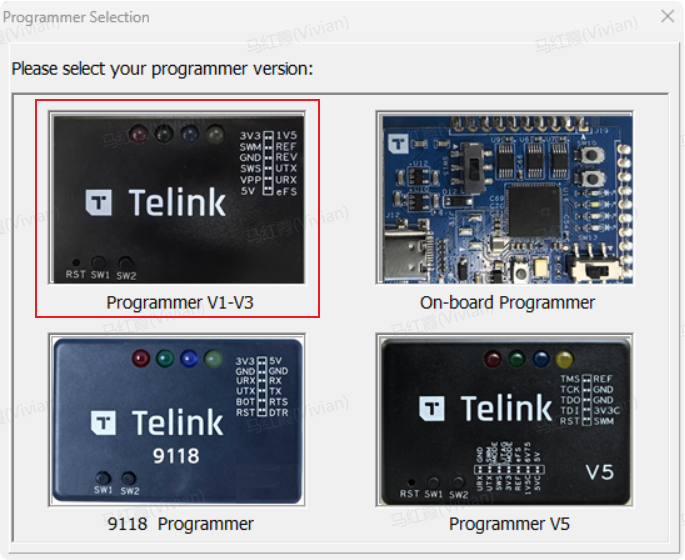

#### 步骤三：烧录固件 

1. 连接设备。

    打开 BDT 软件。固件烧录前，必须确保工具已检测到烧录器，如下图所示。

    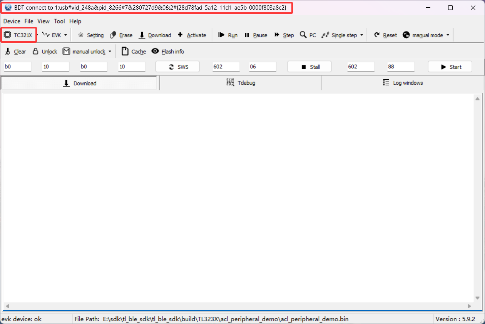

    - 如果BDT没有找到设备，点击 **Refresh** 查看可用设备。
    - 如果 BDT 发现多个设备，所有设备都会列出。点击 **Refresh** 后默认激活第一个设备，您也可以在列表中手动切换目标设备。
  
2. 配置与烧录步骤

    a. 选择目标板的芯片型号。

    在顶部的芯片下拉菜单中，选择您开发板对应的目标芯片，例如 **TC321x** 。

    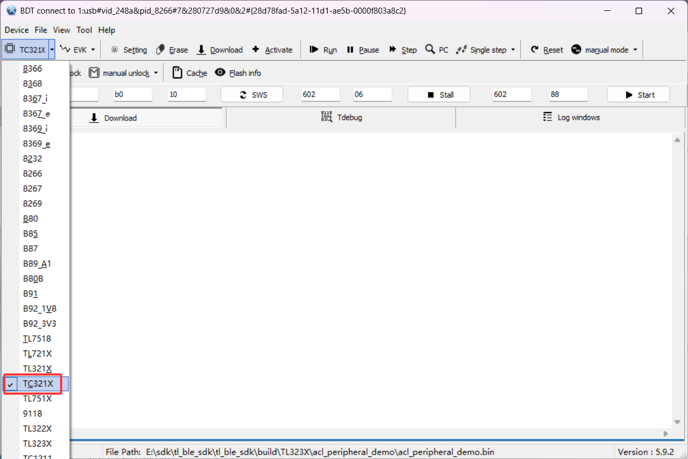

    !!! Info "说明"

        B91 包含 TLSR951x 与 TLSR921x，B92 包含 TLSR952x 与 TLSR922x，B80/B80B 包含 TLSR8208 与 TLSR8373，B85 包含 TLSR825x 与 TLSR8359，B87 包含 TLSR827x 与 TLSR8355。
    
    b. 选择下载模式为 **EVK**。

    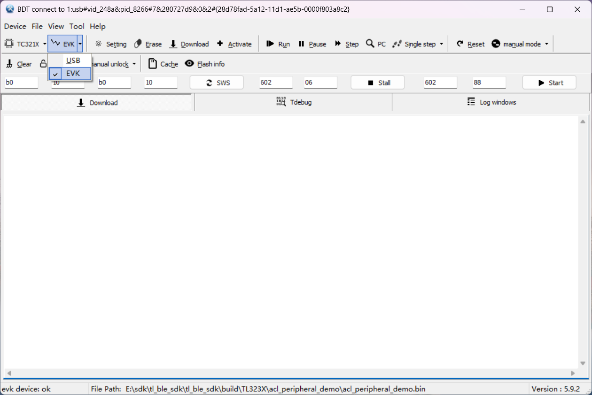

    c. 点击 **Setting** 按钮打开配置窗口，切换到 **Flash** 选项卡。在 **Download Addr** 栏中设定固件的起始偏移地址，默认值 **0x000000** 。

    !!! Info "说明"

        您可以通过配置 **SRAM** 或 **OTP** 选项，将目标固件下载到 SRAM 或 OTP 的目标区域

    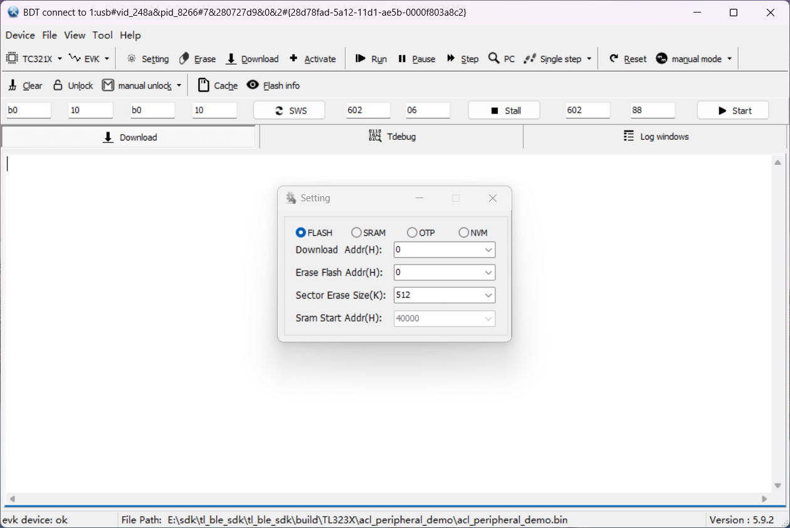
    
    d. 点击菜单栏 **File** -> **Open**/**Reopen**，选中您编译生成的 `.bin` 固件。加载成功后，主界面底部会显示完整文件路径。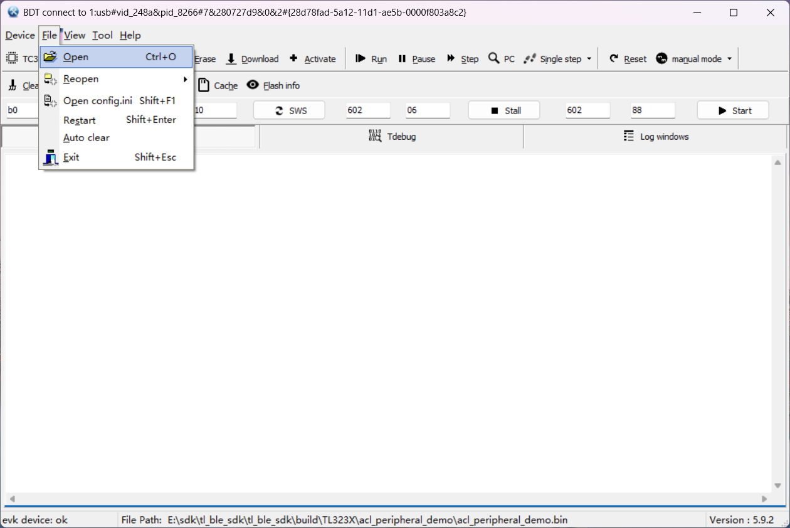
    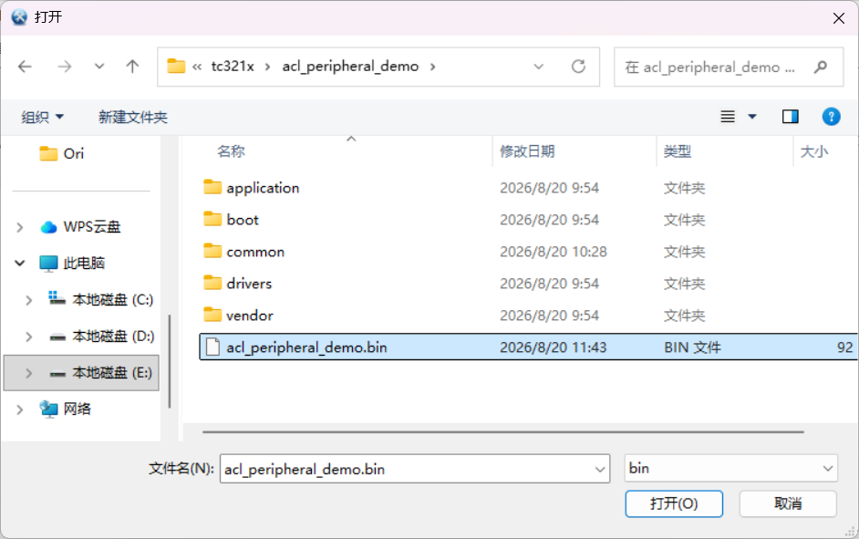
    
    e. 检查目标板和PC之间的连接状态。
    
    - 如果连接状态正常，主界面的左下方会显示**evk device: ok**。
    - 如果主界面的左下方显示 **usb device: not found**，表示目标板没有正确连接到电脑上。
    
    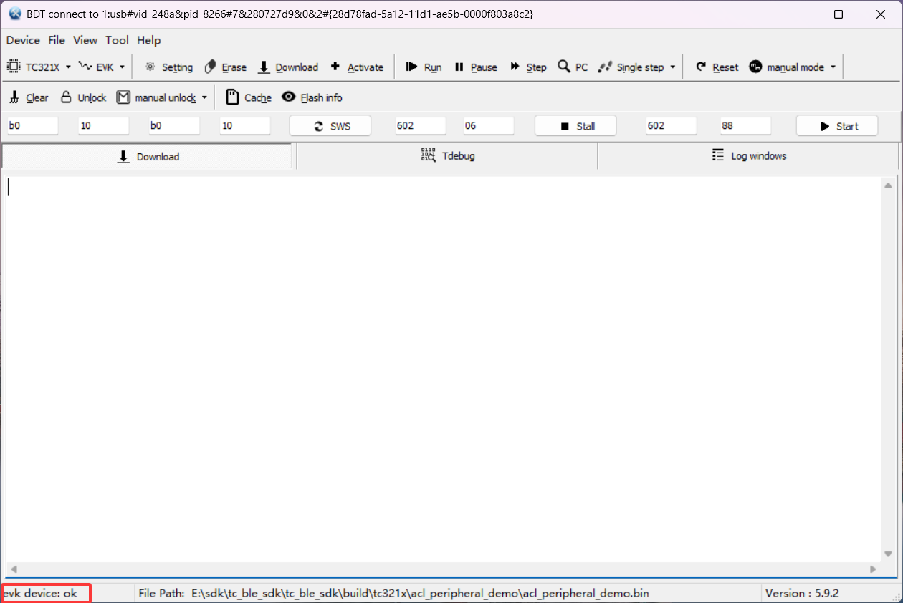
    
    f. 先点击 **Activate**，后点击 **Unlock** 按钮或勾选 **auto unlock** 选项，解除 flash 的写保护状态。
    
    如果 flash 处于写保护状态，则 Download 会失败，所以在下载固件到 flash 之前，需要确保 flash 处于可编程状态。
    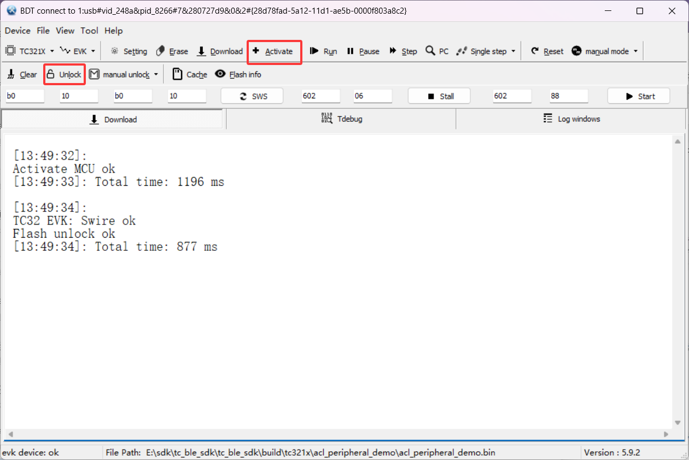
    
    g. 点击 **Download** 按钮，等待日志窗口提示烧录成功。
    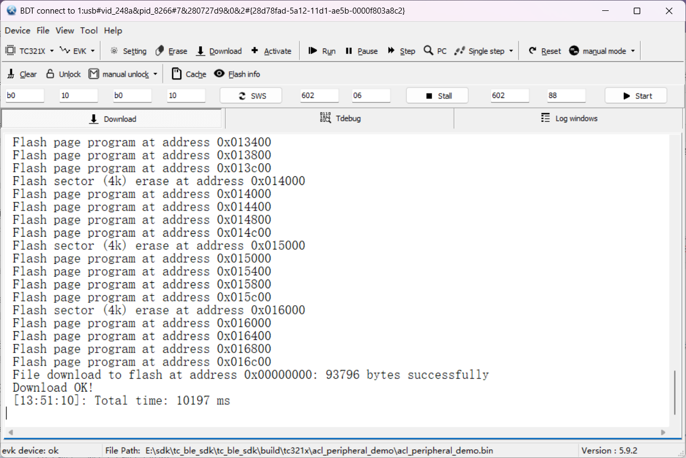
    
    h. 您可以在烧录前将复位模式设为 **auto mode**，或在烧录后切换到 **manual mode** 并点击 **Reset** 按钮手动复位 MCU 运行程序。
    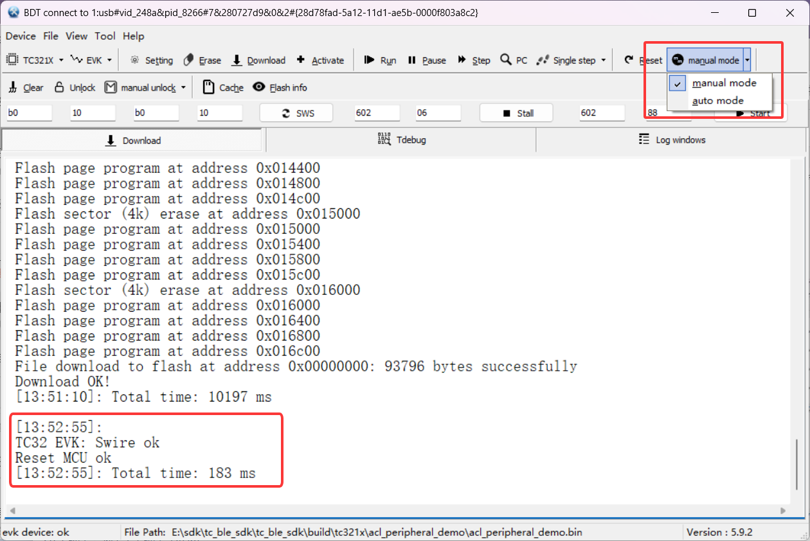

### 验证运行结果 

固件烧录完成后，请按照以下步骤验证示例程序是否已在开发板上正常运行。

**操作步骤**

1. 烧录完成后，开发板将自动复位；如果未自动复位，请按下开发板上的 **Reset** 按键进行复位。
2. 在手机上开启蓝牙，搜索名称为 `periphr_demo` 的 BLE 设备并完成连接。
3. 按下开发板矩阵键盘（图中红框位置）上的音量加/减按键，观察手机音量是否发生变化。

如需查看按键对应的 GPIO 引脚，请参考工程中的配置文件 *TC321X\_C1T357A20.h*。

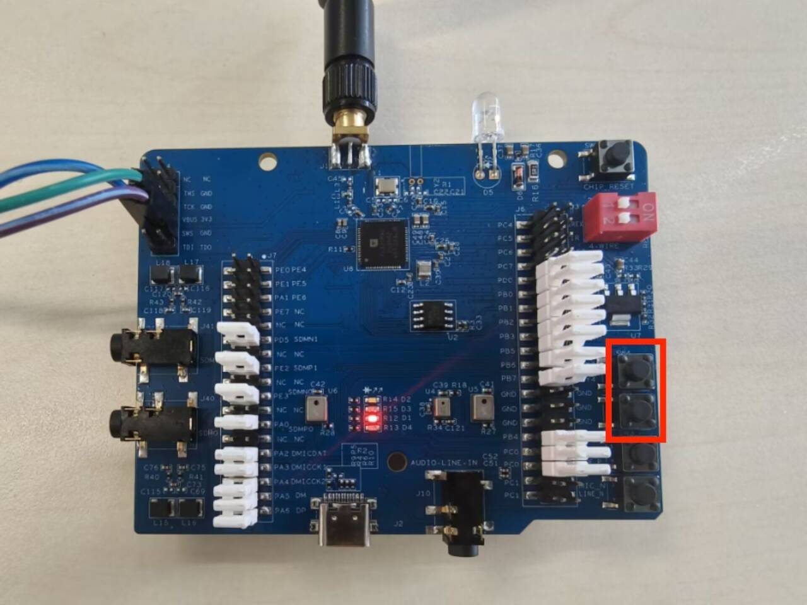

**预期结果**

程序运行正常时，应满足以下条件：

- 手机能够搜索到并成功连接 `periphr_demo` 设备。
- 连接成功后，开发板 LED 指示灯点亮。
- 按下矩阵键盘的音量加/减按键后，手机音量能够同步增加或减小。

如果以上现象均符合预期，则说明示例程序已成功运行，开发环境、程序编译、固件下载及蓝牙通信功能均验证成功。

## 参考文档和资源 

**文档导航**

| 文档                                                                                                                                            | 说明               |
| --------------------------------------------------------------------------------------------------------------------------------------------- | ---------------- |
| [泰凌 tc\_ble\_sdk 开发手册](https://doc.telink-semi.cn/doc/zh/software/res/sdk/ble/tc_ble_sdk_multi_connection_cn/tc_ble_sdk_multi_connection_cn/) | 学习 SDK 功能和具体使用方法 |

**社区与资源**

| 资源                                                                                                          | 说明        |
| ----------------------------------------------------------------------------------------------------------- | --------- |
| [Telink 官方论坛](https://forum.telink-semi.cn/)                                                                | 技术交流与支持   |
| [Telink 官方网站](https://www.telink-semi.com/)                                                                 | 产品中心及文档中心 |
| [Github](https://github.com/telink-semi/tc_ble_sdk) / [Gitee](https://gitee.com/telink-semi/tc_ble_sdk.git) | SDK 源码仓库  |

## 附录1：常见问题 

### 环境安装失败 

- 可能原因：安装路径包含中文
- 解决办法：修改安装路径
- 可能原因：配置安装时未关闭杀毒软件
- 解决办法：关闭电脑上开启的杀毒软件

### 在 VS Code 中使用 CMake 编译时，无法生成所需的 `.bin` 文件 

- 可能原因：CMake 生成的 `.elf` 文件名，与脚本 `tl_check_fw.sh` 中期望的 `.elf` 文件名不一致，导致脚本执行失败，从而无法生成最终的 `.bin` 文件。
- 解决办法：检查并确保 CMake 配置中输出的 `.elf` 文件名，与 `tl_check_fw.sh` 脚本中引用的 `.elf` 文件名完全一致。若发现不一致，请将两者统一修改为相同的文件名，然后重新编译即可。

### 烧录失败 

- 可能原因：未 **Activate** 或 **unlock** 开发板
- 解决办法：每次 **dowmload** 前都需要重新 **Activate** + **unlock**

### 手机连接不到板子 

- 可能原因：开发板未安装天线
- 解决办法：请在预留好的天线口安装天线
